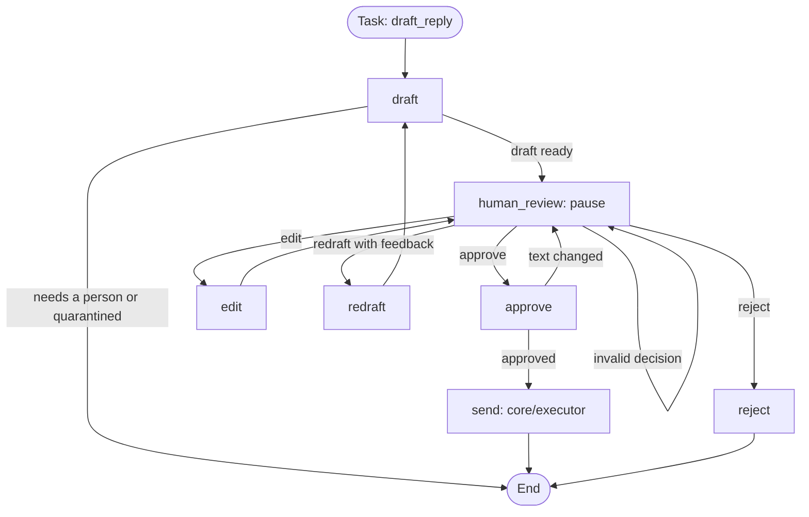
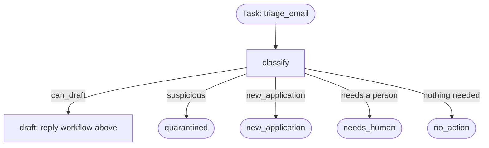

# Architecture

High-level architecture of Hirewall: gateway, orchestrator, services, security and core layers.

TODO

## Orchestrator

`backend/orchestrator/` runs workflows with [LangGraph](https://github.com/langchain-ai/langgraph). A workflow can pause for a person, survive a restart, and continue later. To see the current graph as a Mermaid diagram, run `python scripts/run_drafter_demo.py graph`.

### Reply workflow



| File | Purpose |
|---|---|
| `graph.py` | The nodes, the graph, and `Orchestrator`, which gateway routes should call |
| `router.py` | Which node each task starts at, and where each step goes next |
| `state.py` | `WorkflowState` and the `ReviewDecision` a person submits |
| `checkpoints.py` | Saves paused workflows in `.runtime/` |
| `approval.py` | `DrafterWorkflow`, which connects the drafter, queue, and executor |

### Triage workflow

The `triage_email` task runs the classifier first, and its label chooses the next step:



A label can only lead to `draft`, which runs its own checks and pauses for a person. A wrong label cannot send anything. New applicants stop at `new_application`, and nothing adds them to the candidate list yet: that needs the screener to propose a record, and a person to approve it.

### Rules

1. **Code does the routing.** An email's text never chooses a route, so an attacker's email cannot pick a step.
2. **Only `human_review` leads to `approve`, and only `approve` leads to `send`.** A test checks this.
3. **Code before `interrupt()` must only read.** LangGraph re-runs a paused node from its first line on resume, so a side effect there would repeat. Put each side effect in its own node after the pause.
4. **Nodes must be safe to repeat.** A node can run again after a crash. The approval queue's atomic claim is what stops a second send.
5. **Keep email and draft text out of `WorkflowState`.** It is saved in checkpoints. Store IDs and outcomes, and keep the text in the mailbox and queue.

### Add a service

For a task that runs and finishes, write a function that takes the state and returns the fields to update, then pass it to `Orchestrator`:

```python
def summarize_inbox(state: WorkflowState) -> dict:
    return {"result": {"digest_id": "..."}}

orchestrator = Orchestrator(services={"summarize_inbox": summarize_inbox})
view = orchestrator.start("2026-11-01", task="summarize_inbox")
```

The status becomes `completed`, unless the function sets its own. `start` takes an ID and a task, and each pair gets its own saved workflow. An unknown task goes to a person as `unsupported_task`.

For a task with an outgoing action, such as sending a follow-up, follow the reply workflow instead: add nodes in `graph.py`, submit the action to the approval queue, pause with `human_review`, and send only through `core/executor`.
